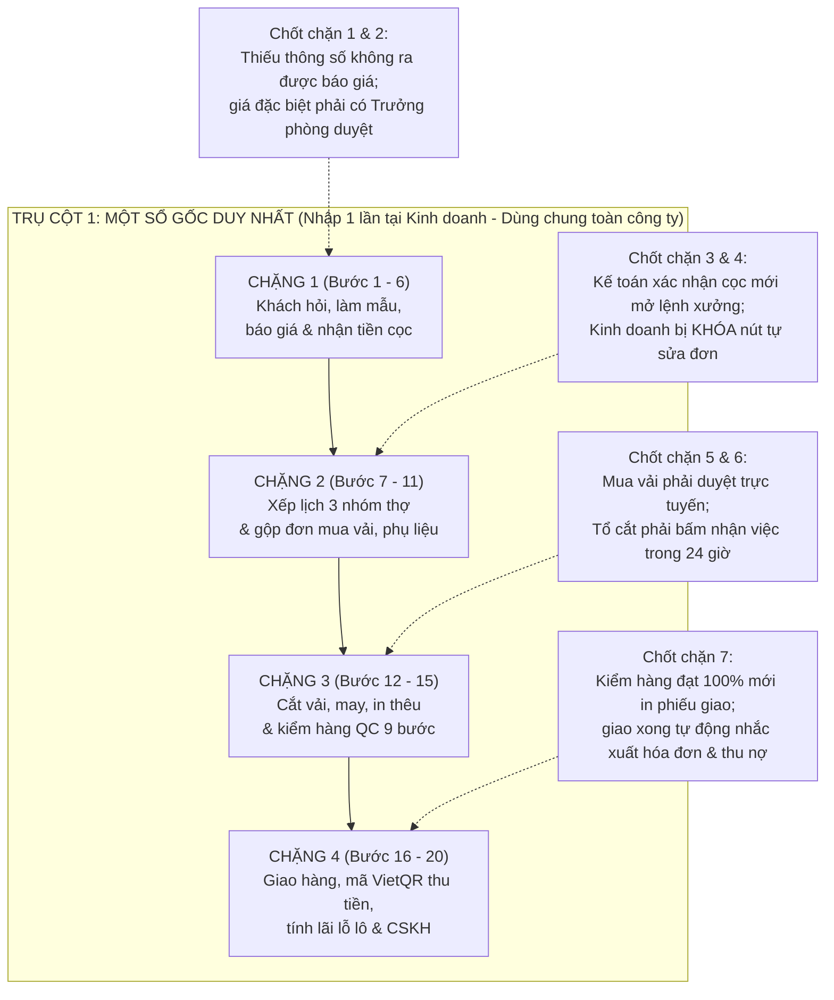

# Quy trình vận hành chuẩn và mô hình hoạt động hệ thống Hoa Tay Mini-ERP

> **Hồ sơ định danh tài liệu dành cho người ra quyết định**
> - Đơn vị tư vấn và xây dựng hệ thống: **Công ty Cổ phần Sunext AI** (`MST: 0318524671` · Tầng 2, 68 Nguyễn Huệ, Phường Sài Gòn, TP. Hồ Chí Minh · Đại diện pháp luật: Ông Lý Đức Toàn, Tổng Giám đốc).
> - Đơn vị thụ hưởng và vận hành: **Công ty Cổ phần Thời trang Đồng phục Hoa Tay** ([[Dong-Phuc-Hoa-Tay]], `MST: 0314883250` · Văn phòng 99 Nguyễn Thái Sơn, Gò Vấp và Xưởng may Hóc Môn, TP. Hồ Chí Minh).
> - Tài liệu căn cứ: Bộ 08 quy trình nội bộ Hoa Tay ban hành ngày `15/04/2026` ([[customers/dong-phuc-hoa-tay/research/dong-phuc-hoa-tay-internal-sop-and-workflow-compendium|Bộ quy trình vận hành nội bộ Hoa Tay]]), khảo sát Phòng Kế toán ngày `07/09/2026` ([[customers/dong-phuc-hoa-tay/meetings/2026-09-07-dong-phuc-hoa-tay-process-survey-responses|Khảo sát hiện trạng quy trình]]) và báo giá `QT-2026-HOATAY-03` ngày `01/11/2026` ([[customers/dong-phuc-hoa-tay/proposals/dong-phuc-hoa-tay-mini-erp-quotation|Báo giá tóm tắt Mini-ERP]]).

---

## Trang 1: Tóm tắt dành cho người ra quyết định (Đọc trong 2 phút)

Tài liệu này giải thích trọn vẹn cách vận hành mới của Đồng phục Hoa Tay bằng ngôn ngữ đời thường. Người đọc không cần biết về công nghệ thông tin hay mở lại các bảng tính cũ. Đọc xong là hiểu ngay.

Nói một cách đơn giản nhất, **Hoa Tay Mini-ERP** là phần mềm quản lý dùng chung trên điện thoại và máy tính của Hoa Tay. Hệ thống được thiết kế riêng cho nghề may đồng phục theo đơn đặt hàng. Thay vì để bốn phòng ban (*Kinh doanh, Sản xuất, Mua hàng và Kế toán*) làm việc trên năm phần mềm rời rạc, hệ thống gom mọi thứ về **một sổ gốc duy nhất**. Dữ liệu chỉ nhập một lần.

### Bảng 1: Tóm tắt quyết định đầu tư và phạm vi thực hiện

| Nội dung cần biết để ra quyết định | Thông tin chốt chính thức theo hồ sơ `QT-2026-HOATAY-03` |
| :--- | :--- |
| **1. Hệ thống này giải quyết vấn đề gì?** | Chấm dứt hoàn toàn cảnh một đơn hàng phải gõ đi gõ lại qua 5 nơi (`GetFly CRM`, các bảng tính `Excel`, `Google Drive`, phần mềm `FAST` và các nhóm `Zalo`). Thông tin chỉ nhập một lần tại phòng kinh doanh và chảy thẳng xuống xưởng may, mua vải, giao hàng và kế toán. |
| **2. Bốn phòng ban nhận được kết quả gì?** | **Kinh doanh** bấm nút biết ngay ngày giao hàng trong `5 phút` (thay vì chờ `2 ngày`). **Sản xuất** tự động xếp lịch cho thợ xưởng, thợ may tại nhà và vệ tinh ngoài mà không sợ trùng lịch. **Mua hàng** tự động gộp danh sách vải cần mua từ nhiều đơn mà không phải lội tìm tin nhắn `Zalo`. **Kế toán** tự động có phiếu thu kèm mã `VietQR`, tự nhắc nợ và biết ngay từng đơn hàng **lãi hay lỗ bao nhiêu tiền** (thay thế hoàn toàn phần mềm `FAST` ở mảng kế toán quản trị nội bộ). |
| **3. Quy mô hệ thống gồm những gì?** | Trọn gói **12 hạng mục (`M0` đến `M11`)** với **52 tính năng nghiệp vụ (`SV-01` đến `SV-52`)**, kèm chuyển toàn bộ dữ liệu khách hàng và đơn đang mở từ `GetFly` sang hệ thống mới, đào tạo nhân viên và bảo hành sửa lỗi miễn phí `03 tháng` sau bàn giao cuối. |
| **4. Thời gian xây dựng mất bao lâu?** | Khoảng **34 tuần** (tương đương **50,2 ngày công** làm việc của đội ngũ kỹ sư), cuốn chiếu từng phần để xưởng Hóc Môn và văn phòng Gò Vấp không bị gián đoạn bất kỳ đơn hàng nào đang may. |
| **5. Tổng chi phí trọn gói là bao nhiêu?** | **`110.410.000 VNĐ`** (chưa gồm thuế GTGT) · Thuế GTGT 10%: **`11.041.000 VNĐ`** · Tổng thanh toán sau thuế: **`121.451.000 VNĐ`**. |
| **6. Thanh toán thế nào để an toàn cho Hoa Tay?** | Chia nhỏ thành **09 đợt thanh toán theo kết quả nghiệm thu thực tế**. Làm xong phần nào, hai bên kiểm tra chạy đúng điều kiện bàn giao mới thanh toán phần đó. Khi bắt đầu dự án (Đợt 1), Hoa Tay chỉ thanh toán **`16.561.500 VNĐ`** (chưa thuế), tức **`18.217.650 VNĐ`** (đã gồm thuế GTGT). |
| **7. Quyết định cần chốt ngay hôm nay là gì?** | Phê duyệt chủ trương triển khai theo báo giá `QT-2026-HOATAY-03` và xếp lịch họp **Buổi khảo sát đầu tiên (`M0`)** trong tuần này giữa Ban Giám đốc, Kinh doanh, Xưởng, Mua hàng và Kế toán để chốt bộ biểu mẫu in ấn thực tế. |

---

## Phần 1: Thực tế hiện nay tại Hoa Tay - Vì sao nhân viên vất vả mà đơn hàng vẫn chậm?

Hoa Tay không hề thiếu quy trình làm việc. Bộ 08 quy trình nội bộ ban hành ngày `15/04/2026` đã quy định rất rõ ràng từng con số. Đơn hàng dưới `100 cái` phải giao trong `12 ngày`, đơn từ `100 đến 500 cái` giao trong `20 ngày` và đơn từ `500 đến 2.000 cái` giao trong `25-35 ngày`. Tỷ lệ hàng may xong đạt chuẩn so với mẫu duyệt phải trên `95%`, còn vải và phụ liệu tồn thừa cuối tháng không được vượt quá `0,5%` chi phí mua hàng.

Vậy tại sao nhân viên vẫn luôn cảm thấy quá tải, còn thời gian phản hồi khách hàng lại kéo dài? Câu trả lời nằm ở chỗ **quy trình thì liền mạch, nhưng công cụ làm việc lại bị cắt vụn thành 5 mảnh rời nhau**.

Hãy nhìn vào hành trình thực tế của một đơn đặt may đồng phục tại Hoa Tay hiện nay:

| Chặng công việc | Công cụ đang dùng | Chuyện gì đang xảy ra mỗi ngày tại văn phòng Gò Vấp và xưởng Hóc Môn? | Thời gian bị mất không đáng có |
| :--- | :--- | :--- | :--- |
| **1. Khách hỏi mua và xin ngày giao hàng** | `GetFly CRM` + Điện thoại + `Zalo` | Nhân viên kinh doanh nhập tên khách vào `GetFly`. Nhưng khi khách hỏi *"Đặt 400 bộ áo bệnh viện thì ngày nào giao được?"*, kinh doanh không tự biết lịch xưởng mà phải gửi bảng tính qua hỏi bộ phận Kế hoạch sản xuất, Kỹ thuật rập và Mua hàng. | Khách phải chờ tới **`2 ngày`** mới nhận được câu trả lời về ngày giao hàng. |
| **2. Chuyển đơn hàng từ Kinh doanh xuống Xưởng** | Bảng tính `File TĐSX` + `Google Drive` | Khi khách đặt cọc, nhân viên kinh doanh mở bảng tính `File Triển khai sản xuất (TĐSX)` ngồi gõ lại từ đầu tên khách, mẫu áo, chất liệu vải và số lượng từng size. Sau đó, bộ phận Kế hoạch sản xuất nhận file rồi lại mở bảng tính `Quản Lý Đơn Hàng Sản Xuất` trên Google Drive để chép lại một lần nữa. | Tốn **`60 phút`** lập file ở phòng kinh doanh và thêm **`20-30 phút/đơn`** chép lại ở khâu kế toán và xưởng. |
| **3. Lập danh sách mua vải và phụ liệu** | `GetFly` + `File TĐSX` + `Nhóm Zalo chuyển tiền` | Nhân viên Mua hàng phải mở cùng lúc phần mềm `GetFly`, bảng tính `File TĐSX` và lội tìm từng ảnh chụp màn hình trong `Nhóm Zalo Khách chuyển tiền` để kiểm tra xem đơn nào đã cọc rồi mới lập `File Duyệt mua hàng`. Nếu có 5 đơn hàng cùng cần mua một loại vải kaki trắng, nhân viên phải tự cộng tay từng đơn. | Tốn từ **`1 đến 3 giờ`** mỗi lần lập danh sách duyệt mua nguyên phụ liệu. |
| **4. Báo tiến độ xưởng và giao hàng** | Bảng tính `QLĐHSX` + `Nhóm Zalo Giao hàng` | Thứ Sáu hằng tuần, nhân viên kế hoạch sản xuất phải mở bảng tính gõ tay tiến độ từng đơn, đơn nào xong thì tô màu chữ từ `ĐEN` sang `XANH`. Khi đóng thùng đi giao, số lượng bao tải, thùng lẻ hay thiếu size lại nhắn qua `Nhóm Zalo Giao hàng`. Giao xong `3 ngày`, nhân viên lại phải mở `GetFly` gõ tay lại ngày đã giao. | Mất công cập nhật hai nơi; tin nhắn báo thiếu hàng dễ bị trôi trong nhóm chat. |
| **5. Thu hồi công nợ và tính lãi lỗ từng đơn** | `File Công nợ` + Phần mềm `FAST` | Cứ đến Thứ Năm hằng tuần, Kế toán mở bảng tính công nợ cập nhật số tiền; đến Thứ Sáu, Kinh doanh vào gõ tay lịch hẹn khách trả. Muốn biết một lô hàng sau khi trừ tiền vải, tiền nút, tiền thợ ngoài còn lãi bao nhiêu, Kế toán (chị Liên) phải gom số từ các bảng tính rồi nhập lại vào phần mềm `FAST`. | Dễ sót hóa đơn và biên bản nghiệm thu; Giám đốc muốn xem báo cáo phải chờ nhân viên tổng hợp cuối tháng. |

Chị Đoàn Thị Kim Liên (Phòng Kế toán) đã xác nhận thực trạng này trong phiếu khảo sát ngày `07/09/2026`. Việc phải tìm kiếm, tải file và nhập lại dữ liệu giữa các bảng tính lặp lại trung bình `3 lần mỗi tuần`. Rủi ro lớn nhất không chỉ là mất thời gian. Khi khách nhắn tin xin đổi số lượng size hoặc dời vị trí thêu logo mà các bảng tính chưa kịp sửa theo, xưởng rất dễ cắt nhầm bản cũ.

Công việc sẽ nhẹ đi rất nhiều nếu cả công ty dùng chung một cuốn sổ điện tử. Không ai phải gõ lại. Một người nhập, cả bốn phòng ban cùng nhìn thấy ngay.

---

## Phần 2: Phương pháp luận và bộ khung vận hành của hệ thống mới

Để xóa bỏ việc chép lại dữ liệu mà vẫn giữ nguyên cách làm nghề may đo của Hoa Tay, chúng tôi thiết kế **Hoa Tay Mini-ERP** theo phương pháp luận **Quản trị Đơn hàng Đặt may Khép kín** (*Make-to-Order Operations Framework*).

Phương pháp luận này kết hợp ba chuẩn mực quản trị sản xuất quốc tế, được may đo vừa khít cho xưởng Hóc Môn và văn phòng Gò Vấp:

1. Chuẩn quy trình chuỗi cung ứng `SCOR` (*Lập kế hoạch - Mua vật tư - Sản xuất - Giao hàng - Thu tiền*): Gom 08 quy trình rời rạc của Hoa Tay thành một đường thẳng liên thông từ lúc khách mới hỏi mua đến khi thu hết tiền về tài khoản.
2. Phương pháp **Xếp lịch theo sức thợ thực tế** (*Finite Capacity Scheduling*): Thay vì nhắm chừng ngày giao hàng bằng cảm tính, máy tính nắm rõ mỗi ngày xưởng có bao nhiêu giờ công trống của thợ nhà và vệ tinh để tự động tính ra ngày giao hàng chính xác.
3. Nguyên tắc **Chốt chặn chất lượng tại nguồn** (*Jidoka / Stage-Gate Control*): Đặt các cửa kiểm soát tự động trên phần mềm giữa các phòng ban. Bước trước làm chưa đủ hoặc chưa đúng thì phần mềm tự động khóa nút, không cho đẩy cái sai xuống bước sau.

Để bất kỳ ai trong công ty cũng hiểu và làm theo được ngay, phương pháp luận trên được đúc kết thành **Bộ khung vận hành "1 Sổ gốc - 4 Chặng đường - 7 Chốt chặn tự động"**:

### Giải thích 3 trụ cột của bộ khung bằng ngôn ngữ đời thường

| Trụ cột vận hành | Trước đây làm bằng tay thế nào? | Bây giờ hệ thống Hoa Tay Mini-ERP tự động làm thế nào? | Lợi ích nhìn thấy ngay |
| :--- | :--- | :--- | :--- |
| **Trụ cột 1: Một sổ gốc duy nhất** | Một đơn hàng phải chép qua 5 nơi (`GetFly`, `File TĐSX`, `File QLĐHSX`, `File Mua hàng`, `File Công nợ`). | Nhân viên kinh doanh nhập thông tin khách và mẫu áo **đúng 1 lần**. Xưởng may, Mua hàng, Kiểm hàng (`QC`), Giao hàng và Kế toán đều mở chung hồ sơ đó để làm tiếp phần việc của mình. | **Không ai phải gõ lại dữ liệu lần thứ hai**; sửa một chỗ (khi được phép) là cả công ty thấy ngay bản mới nhất. |
| **Trụ cột 2: Xếp lịch theo sức thợ thật (Ưu tiên người nhà trước)** | Muốn biết ngày giao phải gọi hỏi xưởng; dễ xảy ra cảnh việc dồn cho vệ tinh ngoài trong khi thợ trong nhà lại ngồi chờ việc. | Phần mềm quản lý 3 nhóm thợ gồm **(1) Thợ tại xưởng Hóc Môn, (2) Thợ nhận đồ về may tại nhà và (3) Xưởng vệ tinh bên ngoài**. Khi có đơn mới, máy tự động xếp kín lịch cho **thợ xưởng và thợ nhà trước**, phần vượt quá sức mới chia ra vệ tinh. | Nhân viên kinh doanh bấm nút biết ngay ngày giao hàng khả thi trong **dưới `5 phút`**; bảo đảm thợ nhà luôn đủ việc làm. |
| **Trụ cột 3: 4 Chặng đường và 7 Chốt chặn tự động** | Nhắc nhở nhau bằng miệng hoặc nhắn tin `Zalo`; đơn đã xuống xưởng nhưng kinh doanh vẫn sửa bảng tính làm thợ may nhầm. | Phần mềm đặt **7 chốt chặn tự động** trên 4 chặng đường. Chưa điền đủ quy cách áo thì nút "Tạo báo giá" không bấm được; Kế toán chưa bấm xác nhận cọc thì xưởng chưa cắt vải; đơn đã vào lịch xưởng thì **Kinh doanh bị khóa cứng nút sửa đơn**. | Chặn đứng lỗi quên việc, sót thông tin và cắt may nhầm mẫu cũ ngay từ gốc. |

---

## Phần 3: Quy trình chuẩn 20 bước từ A đến Z - Một đơn hàng chạy trên hệ thống như thế nào?

Để hình dung rõ nhất cách hệ thống hoạt động mỗi ngày, chúng ta hãy đi theo một đơn hàng thực tế từ đầu đến cuối:

> **Ví dụ thực tế xuyên suốt 20 bước:**
> **Bệnh viện Đa khoa Tâm An** liên hệ Hoa Tay đặt may **400 bộ đồng phục** gồm 3 mẫu khác nhau trên cùng một đơn hàng: **100 áo blouse bác sĩ** (vải kate silk trắng, thêu logo ngực trái), **200 bộ quần áo điều dưỡng** (vải kaki thun xanh, viền cổ) và **100 áo sơ mi hành chính**. Bệnh viện yêu cầu giao áo bác sĩ và điều dưỡng về Cơ sở 1 (Quận 3), còn áo hành chính giao về Cơ sở 2 (Thủ Đức).

Dưới đây là toàn bộ 20 bước công việc (`B01` đến `B20`) chia làm 4 chặng rõ ràng. Hành trình bắt đầu từ lúc Bệnh viện Tâm An nhắn tin hỏi mua và khép lại khi Hoa Tay thu đủ tiền.

### Chặng 1: Từ lúc khách hỏi mua đến lúc chốt hợp đồng và nhận tiền cọc (Bước B01 đến B06)

Ở chặng này, hệ thống giúp nhân viên kinh doanh báo ngày giao chỉ trong `5 phút`. Phần mềm cũng tự động theo dõi áo mẫu cho mượn và khóa chặt thông số đơn hàng ngay khi khách đặt cọc.

| Bước | Tên công việc chuẩn | Ai làm? | Thao tác của nhân viên trên điện thoại / máy tính | Hệ thống Hoa Tay Mini-ERP tự động làm gì ở bên dưới? | Chốt chặn an toàn của hệ thống |
| :---: | :--- | :--- | :--- | :--- | :--- |
| **B01** | **Tiếp nhận khách hỏi mua và mở hồ sơ khách hàng** | Nhân viên Kinh doanh (`NVKD`) | Khi Bệnh viện Tâm An nhắn tin hoặc gọi đến, `NVKD` mở điện thoại nhập tên bệnh viện, người liên hệ và nhu cầu 400 bộ đồng phục vào màn hình phễu bán hàng. | Hệ thống tạo mã khách hàng duy nhất (`SV-01`), mở thẻ cơ hội trên bảng kéo thả (`SV-25`) và bắt đầu đếm thời gian quy định phải gửi báo giá trong `1-4 giờ` (`SV-05`). | Không cho tạo trùng số điện thoại/mã số thuế khách hàng đã có trong sổ gốc (`SV-01`). |
| **B02** | **Quét mã QR chọn mẫu áo và xem ngày giao hàng trong 5 phút** | `NVKD` | Tại phòng trưng bày hoặc khi đi gặp khách, `NVKD` dùng camera điện thoại quét mã `QR` trên áo mẫu có sẵn để lấy thông số, rồi nhập số lượng `400 bộ` và bấm nút **"Kiểm tra ngày giao"**. | Hệ thống tra cứu danh mục sản phẩm (`SV-22`), tự động kiểm tra lịch trống của thợ xưởng, thợ may tại nhà và vệ tinh trong 3 tháng tới (`SV-12`) rồi trả lời ngay: *"Có thể giao hàng vào ngày..."* chỉ trong **dưới `5 phút`** (`SV-13`). | **Chốt chặn 1:** Nếu `NVKD` chưa nhập đủ các thông tin bắt buộc (dòng sản phẩm, số lượng dự kiến, chất liệu), hệ thống khóa nút chuyển sang bước báo giá (`SV-25`). |
| **B03** | **Thiết kế mẫu vẽ, may áo mẫu và quản lý áo mẫu cho mượn** | Thiết kế, Kỹ thuật Rập & `NVKD` | Nếu bệnh viện muốn xem hình vẽ thiết kế (`1-2 ngày`) và may áo mẫu thật (`5-7 ngày`) hoặc mượn áo mẫu có sẵn về thử, `NVKD` bấm tạo phiếu yêu cầu mẫu và phiếu cho mượn mẫu. | Hệ thống giao việc có gắn đồng hồ đếm ngược cho bộ phận Thiết kế và Rập (`SV-05`), lưu file hình ảnh thiết kế dung lượng lớn ngay trong đơn (`SV-07`) và **tự động nhắc `NVKD` đòi lại áo mẫu** khi tới ngày hẹn hoặc trừ tiền mẫu vào đơn hàng (`SV-27`). | Quá hạn làm mẫu (`2 ngày` với hình vẽ, `7 ngày` với áo mẫu may mới) hoặc quá hạn khách mượn mẫu mà chưa trả, hệ thống bật cảnh báo đỏ lên màn hình quản lý (`SV-05`, `SV-27`). |
| **B04** | **Lập báo giá nhiều phương án và duyệt giá đặc biệt** | `NVKD` & Trưởng phòng Kinh doanh | `NVKD` tạo Báo giá lần 1 (ví dụ: phương án vải kate Ý và phương án vải kate Mỹ) gửi bệnh viện. Khi bệnh viện thương lượng giảm giá thêm, `NVKD` tạo Báo giá lần 2 từ bản cũ. | Hệ thống giữ nguyên lịch sử từng lần sửa giá trên cùng một đơn (`SV-23`) để đối chiếu bất cứ lúc nào. Nếu mức giảm giá vượt khung cho phép, đơn tự động chuyển sang màn hình chờ Trưởng phòng Kinh doanh bấm duyệt (`SV-24`). | **Chốt chặn 2:** Đơn hàng có giá đặc biệt hoặc điều khoản ngoài khung chuẩn sẽ không thể in hợp đồng nếu chưa có nút bấm phê duyệt của Trưởng phòng hoặc Giám đốc (`SV-24`). |
| **B05** | **Chốt đơn hàng nhiều mẫu, gắn địa chỉ người nhận và in hợp đồng** | `NVKD` | Khi bệnh viện đồng ý, `NVKD` bấm chuyển báo giá thành **Đơn bán hàng** gồm 3 dòng mẫu áo (100 áo bác sĩ, 200 bộ điều dưỡng, 100 áo hành chính), gắn rõ mẫu nào giao về Quận 3, mẫu nào giao về Thủ Đức và bấm xuất Hợp đồng. | Hệ thống cho phép quản lý nhiều mẫu áo có quy cách khác nhau trong cùng một đơn hàng (`SV-04`), gắn từng mẫu áo về đúng người nhận và địa chỉ giao (`SV-03`), đồng thời tự điền thông tin vào mẫu Hợp đồng chuẩn của Hoa Tay để in hoặc gửi khách ký (`SV-23`). | Kiểm tra tổng số lượng phân bổ theo từng size (`S, M, L, XL, XXL`) và từng điểm giao phải khớp tuyệt đối với tổng `400 bộ` trên hợp đồng (`SV-03`, `SV-04`). |
| **B06** | **Gửi mã VietQR thu tiền cọc và xác nhận mở khóa sản xuất** | `NVKD` & Kế toán (`KT`) | Hệ thống xuất Đề nghị thanh toán tiền cọc có in sẵn mã `VietQR` gửi bệnh viện. Khi tiền vào tài khoản công ty (hoặc đơn được duyệt cho nợ trả sau), Kế toán bấm nút **"Đã nhận cọc"**. | Hệ thống tạo phiếu theo dõi đặt cọc và mã `VietQR` (`SV-42`), ghi nhận bút toán tiền cọc vào sổ kế toán quản trị (`SV-41`) và tự động tạo việc cho bộ phận Sản xuất. | **Chốt chặn 3 & 4:** Chỉ khi Kế toán bấm xác nhận tiền cọc (hoặc duyệt công nợ), đơn hàng mới mở khóa để chuyển xuống xưởng. Ngay giây phút đó, **phần mềm tự động KHÓA CỨNG nút sửa đơn của nhân viên kinh doanh** (`SV-24`). |

---

### Chặng 2: Chuyển xuống xưởng, xếp lịch cho 3 nhóm thợ và đặt mua vải, phụ liệu (Bước B07 đến B11)

Ở chặng này, nhân viên kinh doanh **không còn phải mất 60 phút làm `File TĐSX`** và Mua hàng **không còn mất 1-3 giờ lội `Zalo` lập `File Duyệt mua hàng`** nữa. Mọi thứ tự động chảy từ đơn bán hàng đã khóa ở Bước B06 sang thẳng màn hình của Xưởng và Mua hàng.

| Bước | Tên công việc chuẩn | Ai làm? | Thao tác của nhân viên trên điện thoại / máy tính | Hệ thống Hoa Tay Mini-ERP tự động làm gì ở bên dưới? | Chốt chặn an toàn của hệ thống |
| :---: | :--- | :--- | :--- | :--- | :--- |
| **B07** | **Tự động sinh Lệnh sản xuất và nạp định mức vải, rập chuẩn** | Hệ thống tự chạy & Kỹ thuật Rập (`NVKTR`) | Kỹ thuật Rập kiểm tra lại mã rập của 3 mẫu áo bệnh viện. Nếu là mẫu mới thì cập nhật bảng thông số rập, nhảy size và định mức tiêu hao vải (mỗi áo hết bao nhiêu mét vải chính, vải phối, mấy cái nút) vào hệ thống trong `1 ngày`. | Ngay khi đơn bán hàng được mở khóa ở Bước B06, hệ thống **tự động đẻ ra Lệnh sản xuất** tương ứng mà không ai phải gõ lại (`SV-09`). Toàn bộ mã rập, định mức vải, phụ liệu và quy cách may từ kho dữ liệu gốc sản xuất (`SV-34`) tự động gắn vào lệnh này. | Nếu nhân viên kinh doanh muốn thay đổi bất kỳ chi tiết nào sau thời điểm này, bắt buộc phải gửi yêu cầu điều chỉnh có quản lý phê duyệt và lưu vết lý do sửa (`SV-24`). |
| **B08** | **Xếp lịch tự động vào bảng 3 tháng (Ưu tiên thợ nhà trước vệ tinh)** | Giám đốc Xưởng / Kế hoạch Sản xuất (`KHSX`) | `KHSX` mở màn hình **Bảng kế hoạch sản xuất 3 tháng**, bấm chạy xếp lịch cho đơn 400 bộ của Bệnh viện Tâm An. Nếu có đơn gấp khác cần chèn vào hoặc có thợ xin nghỉ, `KHSX` bấm nút **"Chạy thử phương án"** để xem đơn nào bị ảnh hưởng trước khi chốt. | Hệ thống nhìn toàn bộ bức tranh công việc 3 tháng (tách rõ **phần đơn đã chốt cọc chắc chắn** và **phần đơn dự kiến từ các báo giá đang thương lượng** - `SV-21`). Thuật toán tự động chia việc theo thứ tự ưu tiên: **lấp đầy việc cho thợ tại xưởng Hóc Môn và thợ may tại nhà trước, phần vượt quá mới đẩy ra xưởng vệ tinh bên ngoài** (`SV-12`, `SV-14`). | Khi một tổ thợ hoặc một tuần làm việc bị vượt quá sức chứa, màn hình lập tức tô đỏ cảnh báo quá tải để `KHSX` điều phối lại trước khi hứa ngày giao (`SV-14`). |
| **B09** | **Phát Phiếu triển khai xuống 7 bộ phận và in Phiếu cho tổ cắt** | `KHSX` | Sau khi chốt lịch, `KHSX` chỉ cần bấm một nút **"Phát hành phiếu triển khai"** và bấm in **Phiếu kế hoạch sản xuất cho tổ cắt**. | Hệ thống tự động chia thông tin từ Lệnh sản xuất thành các **Phiếu triển khai** gửi thẳng đến màn hình điện thoại của 7 bộ phận: *Rập, Mẫu, Cắt, Thêu/In, May, Khuy nút/Ủi và Giao hàng* (`SV-35`), đồng thời xuất bản in chuẩn cho Tổ cắt (`SV-36`). | Từng bộ phận chỉ nhìn thấy đúng phần thông số kỹ thuật, mẫu ảnh và số lượng việc của mình, tuyệt đối không thấy giá bán hay thông tin thương mại của khách (`SV-02`, `SV-35`). |
| **B10** | **Tự động tách danh sách cần mua vải và gộp nhiều đơn đặt Nhà cung cấp** | Nhân viên Mua hàng (`NVMH`), Kế toán & Giám đốc | `NVMH` mở màn hình thấy sẵn danh sách vải kate silk trắng, kaki thun xanh, chỉ thêu và nút áo cần mua cho đơn Bệnh viện Tâm An. `NVMH` bấm gửi duyệt trực tuyến, sau đó bấm **"Gộp đơn đặt hàng"** để gom chung vải trắng của đơn này với 3 đơn bệnh viện khác rồi gửi cho Nhà cung cấp (`NCC`). | Hệ thống tự động tách nhu cầu nguyên phụ liệu từ Lệnh sản xuất, trình Kế toán và Giám đốc bấm duyệt ngay trên phần mềm (`SV-39`). Đặc biệt, hệ thống **tự động cộng gộp cùng một mã vải của nhiều đơn hàng khác nhau** để đặt `NCC` một lần cho được giá tốt, nhưng vẫn giữ nguyên mối nối để bấm vào là biết ngay số vải đó thuộc những đơn hàng nào (`SV-40`). | **Chốt chặn 5:** Không có bất kỳ đơn đặt mua vải hay phụ liệu nào được gửi đi nếu chưa qua bước phê duyệt trực tuyến trên hệ thống (`SV-39`). |
| **B11** | **Nhận vải về xưởng, kiểm tra độ co rút và bàn giao cho sản xuất** | `NVMH`, Kiểm hàng (`QC`) & Tổ cắt | Khi nhà cung cấp giao vải và phụ liệu tới (trong vòng `3 ngày` với hàng có sẵn), `NVMH` bấm xác nhận ngày hàng về đủ và lập đề nghị thanh toán hóa đơn `NCC`. Bộ phận `QC` kiểm tra lỗi vải và test độ co rút trước khi ký bàn giao sang Tổ cắt. | Hệ thống cập nhật trạng thái **"Đã đủ nguyên phụ liệu"** lên bảng theo dõi chung để cả Kinh doanh và Xưởng đều thấy (`SV-10`, `SV-39`), gắn chi phí mua vải trực tiếp vào giá thành của đơn Bệnh viện Tâm An (`SV-16`, `SV-45`) và tạo lệnh chờ Giám đốc duyệt chuyển khoản cho `NCC` (`SV-44`). | Nếu vải về trễ hoặc kiểm tra đầu vào bị lỗi co rút/sai màu, hệ thống giữ trạng thái cảnh báo thiếu vật tư và chưa cho phép mở bước cắt hàng loạt (`SV-38`, `SV-39`). |

---

### Chặng 3: Cắt vải, may, in thêu và 9 bước kiểm tra chất lượng tại xưởng (Bước B12 đến B15)

Ở chặng này, toàn bộ hoạt động tại xưởng Hóc Môn và các vệ tinh được cập nhật trực tiếp bằng điện thoại. Thứ Sáu hằng tuần, nhân viên kế hoạch **không còn phải ngồi gõ lại bảng tính và tô màu chữ `ĐEN -> XANH`** nữa vì báo cáo tuần đã được hệ thống tự động tổng hợp.

| Bước | Tên công việc chuẩn | Ai làm? | Thao tác của nhân viên trên điện thoại / máy tính | Hệ thống Hoa Tay Mini-ERP tự động làm gì ở bên dưới? | Chốt chặn an toàn của hệ thống |
| :---: | :--- | :--- | :--- | :--- | :--- |
| **B12** | **Cấp phát vải xuống Tổ cắt và xác nhận nhận việc trong 24 giờ** | Kho NPL & Tổ trưởng Tổ cắt | Kho xuất vải kate trắng và kaki xanh theo đúng định mức của đơn Bệnh viện Tâm An. Tổ trưởng Tổ cắt mở điện thoại bấm nút **"Đã nhận đủ vải và rập"** trong vòng `24 giờ` rồi tiến hành trải vải, cắt và đánh số bán thành phẩm. | Hệ thống lập **Phiếu cấp phát nguyên phụ liệu** gắn chặt với Lệnh sản xuất (`SV-37`). Nếu cắt xong còn dư vải nguyên cây sẽ làm phiếu trả lại; nếu thiếu phải làm phiếu xin cấp bù có ghi rõ lý do để hạch toán thẳng vào giá vốn của lô hàng (`SV-37`, `SV-45`). | **Chốt chặn 6:** Sau `24 giờ` kể từ khi phát phiếu mà Tổ cắt chưa bấm xác nhận nhận đủ vải và rập, hệ thống tự động báo đỏ lên màn hình Giám đốc xưởng (`SV-05`, `SV-35`). |
| **B13** | **May, in thêu, đính nút, ủi và chấm điểm QC 8 bước trên chuyền** | Tổ May, In/Thêu, Hoàn thành & Nhân viên `QC` | Khi hàng đi qua từng công đoạn (sau cắt -> lên chuyền may -> in/thêu logo bệnh viện -> đính nút -> ủi), Tổ trưởng bấm cập nhật tiến độ trên điện thoại (`1-2 chạm`). Nhân viên `QC` đi kiểm tra và bấm chọn số lượng Đạt / Lỗi ngay trên điện thoại. | Hệ thống áp dụng đúng **tỷ lệ kiểm hàng chuẩn của Hoa Tay** (`SV-38`): kiểm vải đầu vào, kiểm bán thành phẩm sau cắt (`10-15%`), kiểm mẫu đầu chuyền, kiểm trên chuyền may (`30%`), kiểm mẫu in/thêu (`100%` mẫu đầu và xác suất đại trà) và kiểm đính nút/ủi (`20%`). Mỗi khi `QC` ghi nhận áo lỗi, hệ thống bắt buộc gắn với **mã lỗi chuẩn** và **tên tổ thợ/vệ tinh làm sai** để cuối tháng lên báo cáo chất lượng theo từng nhóm thợ (`SV-38`). | Ngay khi tổ trưởng hoặc `QC` bấm cập nhật trên điện thoại, màn hình của nhân viên kinh doanh tại văn phòng Gò Vấp tự động nhảy trạng thái theo thời gian thực mà không cần gọi điện hỏi xưởng (`SV-10`). |
| **B14** | **Kiểm tra 100% thành phẩm cuối cùng (Final QC) trước ngày giao 2 ngày** | Nhân viên `QC` (`NVQC`) | Trước ngày hẹn giao cho Bệnh viện Tâm An `2 ngày`, `NVQC` kiểm tra `100%` toàn bộ 400 bộ đồng phục hoàn chỉnh (đường kim mũi chỉ, thông số size, logo thêu, vệ sinh chỉ thừa), chụp ảnh thành phẩm bằng điện thoại và bấm chốt đạt chuẩn. | Hệ thống lưu ảnh chụp thành phẩm đạt chuẩn vào hồ sơ đơn hàng (`SV-07`, `SV-38`) và tính tỷ lệ hàng đạt chuẩn ngay lần đầu (mục tiêu của Hoa Tay là `≥ 95%`). Những áo lỗi phải sửa lại được tách riêng thành lệnh sửa hàng có hạn hoàn thành trong `1-2 ngày`. | **Chốt chặn 7:** Nếu lô hàng chưa được `QC` bấm hoàn tất bước kiểm tra `100%` cuối cùng (`Final QC`), hệ thống khóa chức năng xác nhận sẵn sàng giao hàng (`SV-38`). |
| **B15** | **Đóng bao/thùng, ghi nhận chênh lệch size và báo sẵn sàng giao** | Tổ Đóng gói & `KHSX` | Tổ đóng gói xếp hàng vào bao/thùng riêng cho Cơ sở 1 (Quận 3) và Cơ sở 2 (Thủ Đức), nhập số lượng bao/thùng lên điện thoại và bấm **"Sẵn sàng giao hàng"** trước giờ xe chạy tối thiểu `4 giờ`. | Nếu có bất kỳ sự chênh lệch nào (ví dụ: có 2 áo bác sĩ size L đang phải sửa lại nên giao đợt 1 chỉ có `398/400 bộ`), hệ thống tự động hiện thông báo rõ ràng trên màn hình của `NVKD` và Kế toán để chủ động báo trước cho khách, thay vì nhắn rời rạc trên `Nhóm Zalo Giao hàng` (`SV-10`, `SV-35`). | Hệ thống tự động gom số liệu của đơn này cùng mọi đơn khác trong tuần để sinh ra **Báo cáo sản xuất hằng tuần** cho Giám đốc mà không ai phải tổng hợp tay vào chiều Thứ Sáu (`SV-11`). |

---

### Chặng 4: Giao hàng tận nơi, thu tiền qua mã VietQR, tính lãi lỗ từng đơn và chăm sóc khách hàng (Bước B16 đến B20)

Ở chặng cuối cùng này, hệ thống xóa bỏ hoàn toàn cảnh quên xuất hóa đơn hay quên làm biên bản nghiệm thu. Nhân viên cũng không phải chờ đến Thứ Năm, Thứ Sáu hằng tuần mới mở bảng tính cộng công nợ và nhập vào `FAST`.

| Bước | Tên công việc chuẩn | Ai làm? | Thao tác của nhân viên trên điện thoại / máy tính | Hệ thống Hoa Tay Mini-ERP tự động làm gì ở bên dưới? | Chốt chặn an toàn của hệ thống |
| :---: | :--- | :--- | :--- | :--- | :--- |
| **B16** | **Xác nhận giờ nhận với khách và điều phối xe giao hàng theo điểm nhận** | `NVKD` & Bộ phận Giao hàng | Trước khi xe đi, `NVKD` gọi xác nhận với Bệnh viện Tâm An rồi bấm nút **"Xác nhận thông tin giao hàng"**. Nhân viên giao hàng (hoặc đơn vị vận chuyển) mang hàng kèm Phiếu giao hàng tới Quận 3 và Thủ Đức, chụp ảnh biên nhận ký tên tải lên điện thoại. | Hệ thống in sẵn Phiếu giao hàng tách đúng số lượng cho từng địa chỉ nhận đã khai báo từ Bước B05 (`SV-03`, `SV-24`). Ngay khi giao xong, trạng thái đơn hàng chuyển sang **"Đã giao thành công"** trên toàn hệ thống mà không cần chờ `3 ngày` sau mới nhập lại lên `GetFly` như trước (`SV-10`). | Nếu khách hàng có phản hồi hàng lỗi hoặc cần đổi sửa khi nhận, thông tin được ghi nhận ngay trên đơn để quay vòng bảo hành trong `48 giờ` (`SV-26`). |
| **B17** | **Tự động nhắc xuất Hóa đơn, Biên bản nghiệm thu và gửi mã VietQR thu tiền** | Kế toán (`KT`) | Ngay giây phút đơn hàng chuyển sang trạng thái "Đã giao thành công", màn hình của Kế toán tự động hiện việc cần làm ngay: kiểm tra và bấm xuất **Biên bản nghiệm thu (`BBNT`)** cùng **Đề nghị thanh toán (`ĐNTT`)** có in sẵn mã `VietQR` gửi cho Bệnh viện Tâm An. | Hệ thống **tự động tạo công việc cho Kế toán** ngay khi giao hàng xong để không bao giờ sót hóa đơn hay biên bản nghiệm thu (`SV-28`). Tờ Đề nghị thanh toán tự động trừ đi số tiền khách đã đặt cọc ở Bước B06, tính ra số tiền còn lại và in kèm mã `VietQR` để khách quét mã trả tiền ngay (`SV-42`). | Mọi đơn hàng đã giao nhưng quá `24 giờ` chưa xuất Biên bản nghiệm thu và Đề nghị thanh toán đều hiện cảnh báo nhắc việc trên màn hình Kế toán trưởng (`SV-28`). |
| **B18** | **Tự động tính tuổi nợ, nhắc thu hồi công nợ và quản lý chiết khấu/hoa hồng** | `NVKD`, Kế toán & Giám đốc | Mỗi sáng mở máy, `NVKD` và Kế toán thấy sẵn danh sách những đơn hàng sắp tới hạn hoặc đã quá hạn thanh toán để gọi nhắc khách, không cần chờ đến Thứ Năm và Thứ Sáu mới mở bảng tính công nợ ra cộng tay. | Hệ thống tự động tính số ngày nợ (tuổi nợ), gửi thông báo nhắc thu nợ đúng hạn (`SV-29`) và quản lý riêng các khoản **chiết khấu thương mại hoặc hoa hồng sau bán hàng** dành cho người giới thiệu có phê duyệt của Giám đốc (`SV-43`). | Khoản chiết khấu hoặc hoa hồng chỉ được chi trả khi có phê duyệt của Giám đốc và đối chiếu khớp với số tiền thực thu từ khách hàng (`SV-43`). |
| **B19** | **Tự động tính giá thành lô hàng và lên 8 báo cáo kế toán quản trị (Thay thế FAST)** | Kế toán trưởng / Kế toán viên (`chị Liên`) | Cuối kỳ hoặc ngay sau khi đóng đơn Bệnh viện Tâm An, chị Liên mở phân hệ Kế toán quản trị, bấm chạy tính giá thành và xem ngay đơn hàng 400 bộ này **tổng thu bao nhiêu, tốn hết bao nhiêu tiền vải, tiền phụ liệu, tiền gia công và lãi ròng bao nhiêu tiền**. | Hệ thống tự động gom các bút toán từ bán hàng, mua vải, cấp phát phụ liệu, chi phí nhân công và khấu hao tài sản cố định (`SV-41`, `SV-45`, `SV-46`) để **tính giá vốn và giá thành lô sản phẩm theo đúng công thức của Phòng Kế toán Hoa Tay** (`SV-45`), đồng thời xuất ra **08 báo cáo kế toán quản trị chuẩn** (`SV-47`), thay thế hoàn toàn việc phải nhập lại vào phần mềm `FAST`. | Số liệu tính giá thành lô được kiểm thử đối chiếu khớp tuyệt đối với bảng tính thực tế của chị Liên trên các đơn hàng thật trước khi nghiệm thu bàn giao (`SV-45`, `SV-47`). |
| **B20** | **Tự động nhắc lịch gọi chăm sóc khách hàng, chấm KPI và hỏi đáp báo cáo bằng tiếng Việt** | `NVKD`, CSKH & Giám đốc (`GĐ`) | Hệ thống tự động nhắc nhân viên gọi hỏi thăm Bệnh viện Tâm An vào đúng 3 mốc vàng: **sau `1-3 ngày` nhận hàng, sau `1 tháng` sử dụng và sau `3 tháng`** để hỏi nhu cầu may thêm cho nhân viên mới. Giám đốc mở điện thoại gõ câu hỏi bằng tiếng Việt để xem báo cáo tức thời. | Hệ thống tự động tạo lịch nhắc chăm sóc khách hàng (`SV-05`), tự tổng hợp báo cáo doanh số cuối tháng của phòng kinh doanh (`SV-31`), tự tính điểm `KPI`, tiền thưởng, hoa hồng và theo dõi việc trễ hạn/tạm ứng của từng nhân viên (`SV-32`, `SV-33`). Đặc biệt, **Trợ lý AI báo cáo tiếng Việt** (`SV-30`) trả lời ngay các câu hỏi của Giám đốc (ví dụ: *"Tháng này đơn nào lãi cao nhất, khách nào đang nợ quá hạn?"*) kèm bảng số liệu gốc minh bạch. | Trợ lý AI luôn hiển thị bảng số liệu gốc bên cạnh câu trả lời để Giám đốc kiểm chứng ngay, cam kết đạt độ chính xác tối thiểu `90%` trên bộ `30 câu hỏi mẫu` của Hoa Tay (`SV-30`). |

---

## Phần 4: Mỗi sáng đi làm, 9 vị trí trong công ty mở điện thoại lên sẽ thấy gì và làm gì?

Nhiều chủ doanh nghiệp lo ngại rằng đưa hệ thống mới vào sẽ làm nhân viên rối vì màn hình nhiều nút bấm. Trên **Hoa Tay Mini-ERP**, cơ chế phân quyền chi tiết tới từng ô dữ liệu (`SV-02`) giải quyết gọn nỗi lo này. Mỗi người khi đăng nhập chỉ nhìn thấy đúng công việc của mình trong ngày hôm đó. Giao diện rất gọn gàng.

| STT | Vị trí tại Hoa Tay | Mỗi sáng mở màn hình lên sẽ thấy ngay điều gì? | Thao tác chính trong ngày (Chỉ 1 đến 2 chạm) | Thông tin nào được bảo mật và khóa quyền? (`SV-02`) |
| :---: | :--- | :--- | :--- | :--- |
| **1** | **Giám đốc (`GĐ`)** | Bảng tổng hợp doanh số, tiền mặt, công nợ, lịch xưởng 3 tháng, danh sách các lệnh chi tiền/chiết khấu đang chờ duyệt và ô chat **Trợ lý AI hỏi đáp báo cáo bằng tiếng Việt** (`SV-30`). | Bấm duyệt thanh toán cho nhà cung cấp (`SV-44`), duyệt giá/chiết khấu đặc biệt (`SV-24`, `SV-43`), xem thẻ điểm `KPI` nhân viên (`SV-32`) và gõ câu hỏi tiếng Việt để xem lãi lỗ từng đơn hàng. | Có quyền cao nhất toàn công ty; mọi thao tác sửa số liệu của cấp dưới đều được lưu vào nhật ký để Giám đốc kiểm tra. |
| **2** | **Trưởng phòng Kinh doanh** | Bảng kéo thả toàn bộ khách hàng đang theo đuổi của cả phòng (`SV-25`), danh sách những khách bị bỏ quên quá hạn, các báo giá xin giảm giá đặc biệt đang chờ duyệt (`SV-24`) và bảng doanh số từng nhân viên (`SV-06`, `SV-31`). | Bấm duyệt báo giá đặc biệt, chia khách hàng mới cho nhân viên, đôn đốc các cơ hội bán hàng đang ngâm lâu và bấm xuất báo cáo doanh số cuối tháng ra file Excel đúng mẫu Hoa Tay (`SV-31`). | Xem được toàn bộ khách hàng của phòng kinh doanh và tiến độ chung của xưởng; không sửa được sổ kế toán hay định mức vải của xưởng. |
| **3** | **Nhân viên Kinh doanh & CSKH (`NVKD`)** | Danh sách việc phải làm hôm nay: gọi khách mới, đòi lại áo mẫu cho mượn tới hạn (`SV-27`), gọi chăm sóc khách mốc `3 ngày / 1 tháng / 3 tháng`, nhắc khách trả nợ tới hạn (`SV-29`) và xem các đơn hàng của mình đang may tới đâu (`SV-10`). | Quét mã `QR` trên áo mẫu (`SV-22`), bấm xem ngày giao hàng khả thi trong `5 phút` (`SV-13`), tạo báo giá/hợp đồng (`SV-23`), bấm ghi chú cuộc gọi 1 chạm (`SV-26`) và xác nhận giờ giao hàng (`SV-24`). | Chỉ xem được khách hàng và đơn hàng do mình phụ trách; **bị khóa cứng nút sửa đơn ngay khi đơn đã chuyển xuống xưởng sản xuất** (`SV-24`). |
| **4** | **Nhân viên Thiết kế & Kỹ thuật Rập (`NVKTR`)** | Danh sách các đơn hàng đang chờ vẽ mẫu thiết kế (`hạn 1-2 ngày`) hoặc chờ làm rập, nhảy size và tính định mức vải (`hạn 1 ngày`) có đồng hồ đếm ngược (`SV-05`, `SV-35`). | Tải file thiết kế và hình ảnh mẫu lên đơn hàng (`SV-07`), nhập mã rập, bảng thông số size và định mức vải chính/vải phối/nút/chỉ vào kho dữ liệu gốc sản xuất (`SV-34`). | Chỉ thấy thông số kỹ thuật và hình ảnh mẫu áo; **không nhìn thấy giá bán cho khách hay công nợ của khách hàng**. |
| **5** | **Giám đốc Xưởng / Kế hoạch Sản xuất (`KHSX`)** | **Bảng kế hoạch sản xuất trải dài 3 tháng** tách rõ phần đơn chắc chắn và phần đơn dự kiến (`SV-21`), cảnh báo tổ thợ bị quá tải (`SV-14`), các lệnh sản xuất mới chờ xếp lịch (`SV-09`) và báo cáo tuần tự động (`SV-11`). | Bấm chạy xếp lịch tự động cho 3 nhóm thợ (*xưởng, thợ nhà, vệ tinh* - `SV-12`), chạy thử phương án chèn đơn gấp (`SV-14`), bấm phát **Phiếu triển khai** xuống 7 tổ (`SV-35`) và in **Phiếu kế hoạch cho tổ cắt** (`SV-36`). | Quản lý toàn bộ lịch xưởng, định mức và tiến độ may; không can thiệp vào sổ kế toán hoặc giá bán của phòng kinh doanh. |
| **6** | **Nhân viên Mua hàng & Kho NPL (`NVMH`)** | Danh sách vải và phụ liệu cần mua từ các lệnh sản xuất mới, bảng **gộp nhu cầu mua vải của nhiều đơn hàng theo từng nhà cung cấp** (`SV-40`), lịch theo dõi ngày vải về (`SV-39`) và phiếu xuất vải cho xưởng (`SV-37`). | Chuyển danh sách vật tư đã duyệt thành đơn đặt nhà cung cấp (`SV-39`), gắn chi phí mua vải vào từng đơn (`SV-16`), bấm xác nhận vải về, xuất vải cho tổ cắt (`SV-37`) và lập đề nghị thanh toán cho nhà cung cấp (`SV-44`). | Chỉ làm việc trên dữ liệu mua hàng, nhà cung cấp, giá mua vải và xuất nhập nguyên phụ liệu theo đơn. |
| **7** | **Tổ trưởng Cắt - May - Hoàn thành** | Danh sách các **Phiếu triển khai** và **Phiếu kế hoạch cắt/may** được giao cho tổ mình trong ngày hôm đó, kèm hình mẫu áo, bảng size và hạn phải làm xong (`SV-35`, `SV-36`). | Mở điện thoại bấm nút **"Xác nhận nhận việc"** trong vòng `24 giờ`, bấm cập nhật tiến độ đã cắt xong, đang may, đã thêu hoặc đã ủi xong chỉ bằng 1-2 lần chạm trên màn hình điện thoại (`SV-10`, `SV-18`, `SV-35`). | Chỉ thấy mẫu áo, bảng size, quy cách may và số lượng của tổ mình; **tuyệt đối không thấy tên người liên hệ, số điện thoại hay giá tiền bán cho khách**. |
| **8** | **Nhân viên Kiểm hàng (`NVQC`)** | Danh sách các lô hàng cần kiểm tra trong ngày theo 9 bước `QC` (từ kiểm vải đầu vào, kiểm sau cắt `10-15%`, kiểm trên chuyền may `30%`, kiểm in/thêu `100%` mẫu đến kiểm `100%` thành phẩm cuối trước giao `2 ngày` - `SV-38`). | Cầm điện thoại bấm số lượng Đạt / Không đạt tại từng bước, chọn nguyên nhân lỗi từ danh sách có sẵn, gắn tên tổ thợ làm lỗi và chụp ảnh sản phẩm hoàn chỉnh tải lên đơn hàng (`SV-38`). | Độc lập ghi nhận chất lượng; không ai ở xưởng tự ý xóa được lịch sử chấm lỗi `QC` đã lưu trên hệ thống. |
| **9** | **Kế toán trưởng & Kế toán viên (`chị Liên`)** | Danh sách việc tự động nhảy lên cần làm ngay (xác nhận tiền cọc, xuất hóa đơn, in Biên bản nghiệm thu và Đề nghị thanh toán khi đơn vừa giao xong - `SV-28`), danh sách duyệt mua vải (`SV-39`), bảng tuổi nợ (`SV-29`) và bảng tính giá thành lô (`SV-45`). | Gửi Đề nghị thanh toán có sẵn mã `VietQR` (`SV-42`), duyệt mua hàng, quản lý chiết khấu/hoa hồng (`SV-43`), bấm tính **giá vốn và lãi lỗ từng lô hàng** (`SV-45`), tính khấu hao máy móc (`SV-46`) và xuất **08 báo cáo kế toán quản trị** (`SV-47`). | Toàn quyền trên phân hệ Kế toán quản trị (`M10`) và công nợ (`M4`); tách bạch rõ quyền giữa người lập phiếu và người phê duyệt. |

---

## Phần 5: Bảng so sánh Trước và Sau khi áp dụng quy trình mới trên Hoa Tay Mini-ERP

Bảng dưới đây đặt cạnh nhau cách làm hiện tại và cách làm mới trên hệ thống để Ban Giám đốc thấy rõ từng khoản thời gian và rủi ro được cắt giảm:

| Khâu công việc | Cách làm hiện tại (Rời rạc trên 5 nơi) | Cách làm mới trên Hoa Tay Mini-ERP | Kết quả thay đổi cụ thể |
| :--- | :--- | :--- | :--- |
| **1. Báo ngày giao hàng cho khách B2B** | Kinh doanh phải gửi file hỏi Xưởng, Rập và Mua hàng; chờ kiểm tra thủ công mất **`2 ngày`** mới trả lời được khách. | Kinh doanh mở màn hình tự tra cứu (`SV-13`), máy tính tự kiểm tra lịch trống của 3 nhóm thợ và trả lời trong **dưới `5 phút`**. | Rút ngắn thời gian báo ngày giao từ **`48 giờ` xuống dưới `5 phút`**; chốt đơn nhanh hơn và ưu tiên đủ việc cho thợ nhà. |
| **2. Chuyển đơn hàng từ Kinh doanh xuống Xưởng** | Kinh doanh mất **`60 phút`** làm `File TĐSX`; Kế toán và Xưởng mất thêm **`20-30 phút/đơn`** gõ lại vào `GetFly` và `Google Drive`. | Đơn bán hàng (`SV-04`) vừa nhận cọc là tự khóa sửa (`SV-24`), tự sinh Lệnh sản xuất (`SV-09`) và phát **Phiếu triển khai** xuống 7 tổ (`SV-35`). | **Xóa bỏ 100% thời gian gõ lại dữ liệu** giữa các phòng ban; không bao giờ xảy ra lỗi chép nhầm số lượng size. |
| **3. Lập danh sách duyệt mua vải và đặt Nhà cung cấp** | Mua hàng mất **`1 đến 3 giờ`** mở `GetFly`, `File TĐSX` và lội `Nhóm Zalo chuyển tiền` để làm `File Duyệt mua hàng`; tự cộng tay nhiều đơn. | Danh sách vải cần mua tự tách từ lệnh sản xuất, duyệt trực tuyến (`SV-39`) và **tự động cộng gộp nhu cầu vải của nhiều đơn** theo từng nhà cung cấp (`SV-40`). | Giảm trên **`70%` thời gian** làm đề nghị mua hàng; bấm vào bất kỳ dòng vải nào cũng biết ngay mua cho những đơn hàng nào. |
| **4. Cập nhật tiến độ xưởng và làm báo cáo tuần** | Thứ Sáu hằng tuần ngồi gõ tay vào bảng tính `QLĐHSX`, đổi màu chữ `ĐEN -> XANH`; sau giao `3 ngày` lại mở `GetFly` nhập lại. | Tổ trưởng và `QC` bấm cập nhật trên điện thoại (`SV-18`, `SV-35`, `SV-38`); Kinh doanh nhìn thấy ngay trên màn hình chung (`SV-10`); **báo cáo tuần tự động sinh ra** (`SV-11`). | Xóa bỏ hoàn toàn việc ngồi làm báo cáo sản xuất bằng tay vào chiều Thứ Sáu và việc nhập ngược lên `GetFly`. |
| **5. Xuất hóa đơn, nghiệm thu và nhắc đòi nợ** | Giao hàng báo qua `Zalo`; Thứ Năm Kế toán cộng bảng tính công nợ, Thứ Sáu Kinh doanh gõ tay lịch hẹn trả tiền. | Đơn vừa giao xong là **tự động nhắc Kế toán** xuất hóa đơn, in `BBNT` và `ĐNTT` kèm mã `VietQR` (`SV-28`, `SV-42`); tự tính tuổi nợ và nhắc hạn (`SV-29`). | Không bao giờ quên xuất hóa đơn hay biên bản nghiệm thu; bỏ hẳn lịch ngồi cộng bảng tính công nợ Thứ Năm và Thứ Sáu. |
| **6. Tính giá thành lô hàng và làm kế toán nội bộ** | Gom tay tiền vải, phụ liệu, tiền thợ ngoài từ nhiều bảng tính rồi nhập lại vào phần mềm `FAST`. | Tự động lấy số liệu từ bán hàng, mua vải, xuất kho, giao hàng (`SV-41`); **tự tính giá thành lô khớp cách tính của chị Liên** (`SV-45`) và xuất 08 báo cáo quản trị (`SV-47`). | **Thay thế hoàn toàn phần mềm `FAST`** ở mảng kế toán quản trị nội bộ; biết ngay từng đơn hàng lãi hay lỗ bao nhiêu. |
| **7. Xem báo cáo điều hành và tính lương thưởng KPI** | Cuối tháng nhân viên phải ngồi cộng tay doanh số, chấm điểm `KPI`, tính hoa hồng và theo dõi tạm ứng. | Giám đốc hỏi đáp trực tiếp với **Trợ lý AI bằng tiếng Việt** trên điện thoại (`SV-30`); hệ thống tự tính thẻ điểm `KPI`, thưởng và hoa hồng (`SV-32`, `SV-33`). | Giám đốc nắm số liệu tức thì mọi lúc mọi nơi mà không phải chờ nhân viên tổng hợp bảng tính cuối tháng. |

---

## Phần 6: Chi phí đầu tư, lộ trình 9 đợt thanh toán và bước khởi động ngay tuần này

Phần này trình bày đầy đủ mọi con số tài chính, tiến độ thanh toán và ranh giới công việc theo đúng báo giá chính thức `QT-2026-HOATAY-03` (ngày `01/11/2026`, hiệu lực `30 ngày`) để Ban Giám đốc Hoa Tay có đủ thông tin phê duyệt ngay mà không cần tra cứu sang tài liệu khác.

### 6.1. Bảng chi phí trọn gói 12 hạng mục công việc (`M0` đến `M11`)

Đơn giá ngày công kỹ sư đã áp dụng mức ưu đãi dành riêng cho Hoa Tay là **`2.200.000 VNĐ/ngày công`** (giảm từ mức chuẩn `2.500.000 VNĐ/ngày công`, chưa gồm thuế GTGT).

| Mã | Tên hạng mục công việc (Giải thích dễ hiểu) | Cách tính chi phí | Số ngày công | Thành tiền trước thuế (VNĐ) | Điều kiện bàn giao rõ ràng để Hoa Tay nghiệm thu |
| :---: | :--- | :--- | :---: | :---: | :--- |
| **M0** | **Khảo sát thực tế và chốt bộ biểu mẫu, quy trình** (`SV-05`, `SV-08`, `SV-50`) | Theo phạm vi đánh giá | `2,7` | `5.940.000` | Hai bên ký xác nhận tài liệu mô tả chi tiết, danh sách biểu mẫu in ấn (*Báo giá, Hợp đồng, Phiếu cắt, BBNT, ĐNTT*) và công thức tính giá thành với chị Liên. |
| **M1** | **Dựng nền tảng hệ thống, phân quyền 9 vị trí và giao diện điện thoại** (`SV-01` đến `SV-04`, `SV-07`, `SV-18`) | Theo mốc nghiệm thu | `4,2` | `9.240.000` | Đăng nhập được 9 vai trò trên điện thoại và máy tính; ẩn được giá bán với tài khoản thợ xưởng; tạo được đơn hàng có nhiều mẫu áo và nhiều địa chỉ nhận. |
| **M2** | **Quản lý hồ sơ khách hàng và danh mục sản phẩm có quét mã QR** (`SV-06`, `SV-22`) | Theo mốc nghiệm thu | `3,5` | `7.700.000` | Tạo khách hàng không bị trùng; xem được toàn bộ lịch sử mua hàng, công nợ, mẫu mượn trên 1 màn hình; dùng điện thoại quét mã `QR` ra ngay thông tin mẫu áo. |
| **M3** | **Quản lý phễu bán hàng, báo giá nhiều phiên bản, hợp đồng và áo mẫu mượn** (`SV-23` đến `SV-27`) | Theo mốc nghiệm thu | `5,1` | `11.220.000` | Chạy thông suốt từ lúc khách hỏi -> báo giá nhiều lần -> duyệt giá đặc biệt -> in hợp đồng -> khóa nút sửa của kinh doanh khi đơn chuyển xuống xưởng; nhắc đòi áo mẫu. |
| **M4** | **Tự động nhắc việc cho Kế toán khi giao hàng và theo dõi tuổi nợ** (`SV-28`, `SV-29`) | Theo mốc nghiệm thu | `2,5` | `5.500.000` | Đơn vừa bấm giao thành công là tự động tạo việc nhắc Kế toán xuất hóa đơn, `BBNT`, `ĐNTT`; tự tính tuổi nợ và nhắc thu hồi nợ đúng hạn. |
| **M5** | **Trợ lý AI hỏi đáp báo cáo bằng tiếng Việt, báo cáo kinh doanh và chấm KPI** (`SV-30` đến `SV-33`) | Theo đầu ra | `4,9` | `10.780.000` | Trợ lý AI trả lời đúng tối thiểu **`90%`** trên bộ `30 câu hỏi tiếng Việt` của Hoa Tay và luôn hiện số gốc; xuất báo cáo kinh doanh cuối tháng ra Excel; tự tính `KPI` và hoa hồng. |
| **M6** | **Xếp lịch tự động cho 3 nhóm thợ và tra ngày giao hàng trong 5 phút** (`SV-12` đến `SV-14`, `SV-21`, `SV-34`) | Theo mốc nghiệm thu | `5,4` | `11.880.000` | Bảng kế hoạch 3 tháng tách rõ phần đơn chắc chắn và dự kiến; ưu tiên xếp việc cho thợ xưởng và thợ nhà trước vệ tinh; kinh doanh tự bấm xem ngày giao trong **dưới `5 phút`**. |
| **M7** | **Tự sinh Lệnh sản xuất, phát Phiếu triển khai xuống 7 tổ và in Phiếu cắt** (`SV-09` đến `SV-11`, `SV-19`, `SV-35`, `SV-36`) | Theo mốc nghiệm thu | `4,2` | `9.240.000` | Đơn bán tự chuyển thành Lệnh sản xuất không cần gõ lại; phát phiếu việc xuống 7 tổ; in được Phiếu kế hoạch cho tổ cắt; tự động sinh báo cáo sản xuất hằng tuần. |
| **M8** | **Quản lý xuất vải cho xưởng và kiểm tra chất lượng QC 9 bước** (`SV-37`, `SV-38`) | Theo mốc nghiệm thu | `2,2` | `4.840.000` | Ghi nhận xuất vải, trả vải thừa và xin cấp bù theo từng lệnh sản xuất; nhân viên `QC` bấm chấm đạt/lỗi qua 9 bước trên điện thoại và lên báo cáo lỗi theo từng nhóm thợ. |
| **M9** | **Quản lý duyệt mua vải theo đơn và gộp nhu cầu mua từ nhiều đơn hàng** (`SV-15`, `SV-16`, `SV-39`, `SV-40`) | Theo mốc nghiệm thu | `4,5` | `9.900.000` | Duyệt mua vải trực tuyến; tự động cộng gộp cùng một mã vải của nhiều đơn để đặt nhà cung cấp 1 lần nhưng bấm vào vẫn biết thuộc đơn nào; gắn chi phí vải vào từng đơn. |
| **M10** | **Kế toán quản trị nội bộ, tính giá thành lô hàng và mã VietQR (Thay thế FAST)** (`SV-41` đến `SV-47`) | Theo mốc nghiệm thu | `8,5` | `18.700.000` | In Đề nghị thanh toán có sẵn mã `VietQR`; quản lý chiết khấu/hoa hồng; duyệt thanh toán `NCC`; **tính giá thành lô khớp số với chị Liên**; xuất đủ 08 báo cáo kế toán quản trị thay thế `FAST`. |
| **M11** | **Chuyển dữ liệu từ GetFly sang, chạy thử nghiệm, đào tạo và bảo hành 3 tháng** (`SV-48` đến `SV-52`) | Theo đầu ra | `2,5` | `5.470.000` | Chuyển toàn bộ khách hàng và đơn đang mở từ `GetFly` sang không lệch số; đào tạo 4 nhóm nhân sự kèm video hướng dẫn ngắn; bảo hành sửa lỗi miễn phí `03 tháng` sau bàn giao cuối. |
| **Tổng** | **Trọn gói 12 hạng mục (`M0` đến `M11`) - 52 tính năng (`SV-01` đến `SV-52`)** | **Trọn gói** | **`50,2`** | **`110.410.000`** | **Thuế GTGT 10%: `11.041.000 VNĐ` · Tổng thanh toán sau thuế: `121.451.000 VNĐ`** |

---

### 6.2. Lộ trình 34 tuần và 09 đợt thanh toán an toàn theo kết quả nghiệm thu

Hoa Tay không phải trả toàn bộ số tiền một lúc. Khoản đầu tư được chia làm **09 đợt thanh toán gắn chặt với kết quả bàn giao thực tế** trong suốt 34 tuần:

| Đợt | Thời điểm thanh toán và điều kiện nghiệm thu thực tế | Tỷ lệ | Tiền trước thuế (VNĐ) | Thuế GTGT 10% (VNĐ) | Tổng thanh toán gồm thuế (VNĐ) |
| :---: | :--- | :---: | :---: | :---: | :---: |
| **Đợt 1** | Ngay sau khi ký hợp đồng để khởi động khảo sát `M0` và dựng nền `M1`. | `15%` | `16.561.500` | `1.656.150` | **`18.217.650`** |
| **Đợt 2** | Sau khi chốt xong toàn bộ biểu mẫu, quy trình (`M0`) và chạy được nền tảng hệ thống, phân quyền 9 vị trí trên điện thoại (`M1`). | `10%` | `11.041.000` | `1.104.100` | **`12.145.100`** |
| **Đợt 3** | Sau khi Phòng Kinh doanh dùng được hồ sơ khách hàng, quét mã `QR` mẫu áo (`M2`), làm báo giá đa phiên bản, hợp đồng và khóa sửa đơn (`M3`). | `12%` | `13.249.200` | `1.324.920` | **`14.574.120`** |
| **Đợt 4** | Sau khi Xưởng dùng được tính năng xếp lịch 3 nhóm thợ và Kinh doanh tự bấm xem được ngày giao hàng trong `5 phút` (`M6`). | `10%` | `11.041.000` | `1.104.100` | **`12.145.100`** |
| **Đợt 5** | Sau khi chạy xong Lệnh sản xuất tự động, Phiếu triển khai 7 tổ, Phiếu cắt (`M7`) và quản lý xuất vải, chấm `QC` 9 bước trên điện thoại (`M8`). | `12%` | `13.249.200` | `1.324.920` | **`14.574.120`** |
| **Đợt 6** | Sau khi Mua hàng dùng được tính năng duyệt mua vải và gộp đơn đặt nhà cung cấp (`M9`), cùng tính năng tự nhắc việc Kế toán và tuổi nợ (`M4`). | `10%` | `11.041.000` | `1.104.100` | **`12.145.100`** |
| **Đợt 7** | Sau khi Kế toán (`chị Liên`) nghiệm thu xong phân hệ Kế toán quản trị, mã `VietQR`, tính giá thành lô hàng và 08 báo cáo thay thế `FAST` (`M10`). | `13%` | `14.353.300` | `1.435.330` | **`15.788.630`** |
| **Đợt 8** | Sau khi Giám đốc nghiệm thu xong Trợ lý AI hỏi đáp báo cáo bằng tiếng Việt (đạt `≥ 90%`), báo cáo kinh doanh cuối tháng và bảng chấm `KPI` (`M5`). | `8%` | `8.832.800` | `883.280` | **`9.716.080`** |
| **Đợt 9** | Sau khi chuyển xong dữ liệu từ `GetFly` sang, đào tạo toàn bộ nhân viên và ký biên bản bàn giao đưa hệ thống vào chạy chính thức (`M11`). | `10%` | `11.041.000` | `1.104.100` | **`12.145.100`** |
| **Cộng** | **Tổng cộng 09 đợt thanh toán trọn gói toàn dự án** | **`100%`** | **`110.410.000`** | **`11.041.000`** | **`121.451.000`** |

---

### 6.3. Minh bạch những gì ĐÃ BAO GỒM và CHƯA BAO GỒM để không phát sinh hiểu lầm

Để hai bên làm việc rõ ràng ngay từ ngày đầu, dưới đây là ranh giới cụ thể của gói đầu tư `110.410.000 VNĐ` (chưa thuế):

1. Những phần **ĐÃ BAO GỒM trọn gói** trong chi phí trên:
   Toàn bộ công khảo sát, thiết kế, lập trình 52 tính năng (`SV-01` đến `SV-52`), chuyển dữ liệu khách hàng và các đơn hàng đang mở từ `GetFly` sang hệ thống mới (`SV-50`), tổ chức 4 buổi đào tạo trực tiếp cho 4 nhóm nhân sự kèm video hướng dẫn ngắn (`1-3 phút/video` - `SV-49`) và **bảo hành sửa lỗi miễn phí `03 tháng`** kể từ ngày ký bàn giao cuối cùng (`SV-52`).
2. Các khoản **chi phí hạ tầng bên thứ ba do Hoa Tay tự đứng tên và trả trực tiếp cho nhà cung cấp** (Sunext hỗ trợ cài đặt miễn phí, không thu chênh lệch):
   Tiền thuê máy chủ đám mây (VPS/Cloud Server) dự kiến khoảng **`300.000 - 1.500.000 VNĐ/tháng`**; tiền duy trì tên miền riêng của Hoa Tay khoảng **`300.000 - 800.000 VNĐ/năm`**; và tiền cước sử dụng trí tuệ nhân tạo cho tính năng hỏi đáp báo cáo tiếng Việt (`SV-30`) dự kiến khoảng **`100.000 - 500.000 VNĐ/tháng`** tùy theo số lần hỏi thực tế.
3. Những hạng mục **CHƯA BAO GỒM** trong phạm vi báo giá này (nếu sau này Hoa Tay có nhu cầu mở rộng sẽ báo giá bổ sung riêng):
   - Hệ thống thay thế hoàn toàn phần mềm `FAST` ở mảng **kế toán quản trị nội bộ và tính giá thành lô**, nhưng **không làm sổ kế toán thuế** hay kết nối trực tiếp lên cổng Thuế điện tử / Hóa đơn điện tử nhà nước.
   - Hệ thống quản lý mua vải, cấp phát vải và tính chi phí vải **theo từng đơn hàng**, chưa bao gồm phân hệ quản lý tồn kho chi tiết từng cây vải lẻ hay kiểm kê kho định kỳ độc lập.
   - Hệ thống tạo sẵn **mã `VietQR`** trên phiếu đề nghị thanh toán để khách quét trả tiền và Kế toán bấm xác nhận, chưa bao gồm cổng tự động đọc biến động số dư ngân hàng hay nối tự động vào tổng đài điện thoại, Zalo OA, Facebook.

---

### 6.4. Bước tiếp theo duy nhất cần làm ngay trong tuần này

Để khởi động dự án đúng tiến độ, Ban Giám đốc Hoa Tay chỉ cần duyệt chủ trương và chọn lịch họp **Khởi động khảo sát `M0`** (khoảng `2 giờ`) ngay trong tuần này.

Buổi họp gồm Ban Giám đốc, đại diện Phòng Kinh doanh, bộ phận Kế hoạch sản xuất / Xưởng Hóc Môn, bộ phận Mua hàng và Phòng Kế toán (chị Đoàn Thị Kim Liên). Tại đây, đội ngũ **Công ty Cổ phần Sunext AI** sẽ nhận bộ mẫu phiếu in ấn đang dùng tại Hoa Tay (*Báo giá, Hợp đồng, Phiếu cắt, Phiếu giao hàng, Biên bản nghiệm thu, Đề nghị thanh toán và bảng tính giá thành của chị Liên*). Hai bên chốt xong biểu mẫu là bắt tay vào xây dựng ngay.

<!-- brainos-graph:start -->
> [!info]- Graph connections
> - **Customer:** [[Dong-Phuc-Hoa-Tay]]
> - **Engagement:** [[Dong-Phuc-Hoa-Tay-AI-Opportunity-Assessment]]
> - **Derived from:** [[customers/dong-phuc-hoa-tay/research/dong-phuc-hoa-tay-internal-sop-and-workflow-compendium]]
> - **Derived from:** [[customers/dong-phuc-hoa-tay/proposals/dong-phuc-hoa-tay-mini-erp-quotation]]
> - **Derived from:** [[customers/dong-phuc-hoa-tay/meetings/2026-09-07-dong-phuc-hoa-tay-process-survey-responses]]
> - **Derived from:** [[customers/dong-phuc-hoa-tay/research/dong-phuc-hoa-tay-ai-operational-audit]]
> - **Related:** [[customers/dong-phuc-hoa-tay/sessions/dong-phuc-hoa-tay-crm-needs-survey]]
<!-- brainos-graph:end -->
